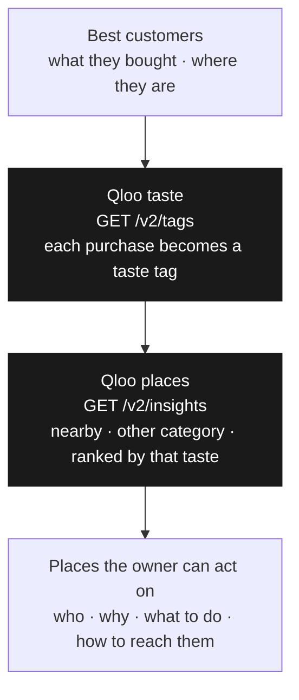

# Customer Acquisition Advisor (CAA)

**CAA finds the business next door whose customers already love what you sell—so you grow through partnerships instead of ads.**

In the Federal Reserve Banks’ 2026 Small Business Credit Survey, 57% of U.S. small employer firms cited reaching customers and growing sales as their most common operational challenge—CAA targets that gap with nearby cross-category partners instead of more ad spend.

A local shop already knows its best customers by what they buy. CAA reads those purchases and where they come from, then returns a short list of **nearby businesses in other categories** whose crowds share that taste. Each result is a **real Qloo place** with a partnership idea: why it fits, what to propose, and a next step (plus address, phone, or website when Qloo returns them).

**How Qloo fits:** Sales data alone cannot rank “who should I walk into?” Qloo maps each purchase to taste tags on its graph, then **Insights** returns ranked nearby places outside your category. Names, affinity, and match reasons come from Qloo. The **LLM only drafts copy** for places Qloo already returned—it does not invent partners.



More narrative: [docs/customer-acquisition-advisor.md](docs/customer-acquisition-advisor.md).

## Try the demo

Pick one of three built-in businesses (coffee shop, salon, Mexican restaurant) and run an analysis:

1. Score valuable customers from demo sales data (committed under `data/scenarios/`; regenerate with `make generate-scenarios` if you want fresh synthetic orders).  
2. Map menu lines → **Qloo tags** → **Insights** (nearby, other category).  
3. Draft partnership ideas for those candidates with the LLM.

The hosted hackathon demo uses scenario data only. Optional locally: `USE_LIVE_CONNECTOR=1` + Square for live business data (not enabled on the public URL).

On the public demo, more than one visitor can run an analysis at the same time. Each run still calls Qloo to find partners. If you pick the same demo business again before the server’s cache times out, the app reuses the partnership copy it already generated instead of calling the LLM again. Adjust that behavior with `ADVISOR_LLM_CACHE` and `ADVISOR_LLM_CACHE_TTL_SECONDS` (see the environment table). Unsuccessful runs are not cached.

## Requirements

- Go 1.23+  
- Node.js 20+ (to build the UI)  
- `.env` from [.env.example](.env.example) with `QLOO_API_KEY`, `LLM_*`  

## Run locally

```bash
cp .env.example .env   # fill keys
make generate-scenarios
cd src/web && npm ci && npm run build   # → src/api/static
cd ../api && go run .
```

Open http://localhost:8080 (or `PORT` from env).

## API (summary)

| Method | Path | Purpose |
|--------|------|---------|
| GET | `/api/health` | Health check |
| GET | `/api/config` | Config status (no secrets) |
| POST | `/api/runs` | Start analysis |
| GET | `/api/runs/latest`, `/api/runs/{id}` | Poll results |

## Environment (common)

| Variable | Purpose |
|----------|---------|
| `QLOO_API_KEY`, `QLOO_BASE_URL` | Qloo hackathon API |
| `LLM_PROVIDER`, `LLM_BASE_URL`, `LLM_MODEL`, `LLM_API_KEY` | LLM for partnership copy |
| `SCENARIO` | Default demo when not picking in UI |
| `ADVISOR_LLM_CACHE` / `ADVISOR_LLM_CACHE_TTL_SECONDS` | Per-scenario LLM cache (default on; TTL in seconds, configurable) |
| `QLOO_LOCATION_RADIUS_METERS` | Partner search radius (~10 km default) |
| `ADVISOR_PIPELINE_AUDIT` | Write pipeline audit markdown locally |
| `ADVISOR_MATCH_CHAIN` | Show “how this match was made” in UI |
| `USE_LIVE_CONNECTOR` | Square instead of scenario JSON |

See `.env.example` for Square and Postgres options.

## Docker (Render)

From repo root:

```bash
docker build -t customer-acquisition-advisor .
docker run --env-file .env -p 8080:8080 customer-acquisition-advisor
```

Deploy notes: [docs/render-deployment.md](docs/render-deployment.md).  
Hackathon checklist: [docs/hackathon-submission.md](docs/hackathon-submission.md).

## Tests

```bash
make test
```

Unit tests only for the public demo (`make test`). Live Square/Qloo/e2e harnesses were removed from this tree.

## License

MIT — see [LICENSE](LICENSE).
