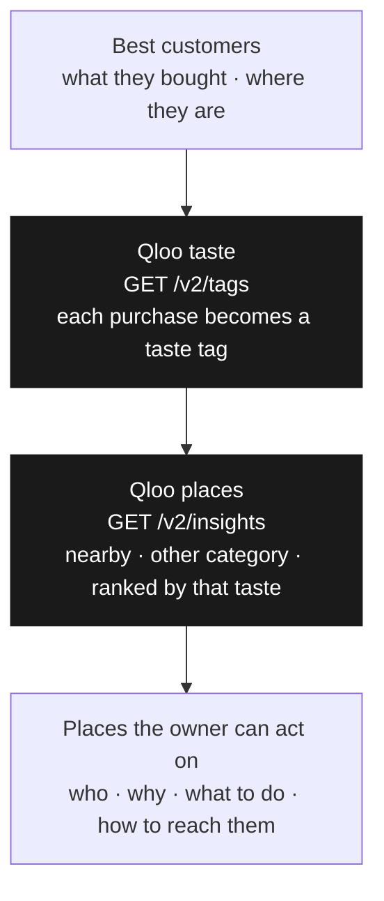

# Customer Acquisition Advisor

## Name

Customer Acquisition Advisor (CAA)

## One line

CAA finds the business next door whose customers already love what you sell, so you grow through them instead of through ads.

## What it does

A local shop already knows its best customers by what they buy. CAA reads those purchases and the neighborhood they come from, then returns a short list of nearby businesses in other categories whose crowds share that taste. Each result is a real Qloo place with a partnership idea: why it fits, what to propose, and a concrete next step. When Qloo returns address, phone, or website on that entity, the UI shows them; otherwise the owner still gets the who and the pitch. A café stops advertising to strangers and walks into the bookstore, salon, or gallery its own regulars would already like.

## How CAA uses Qloo

Qloo is the part that cannot be guessed. The shop’s own sales say what its best customers bought and where they are. Qloo turns each purchase into a taste on its graph, then ranks real nearby places by how strongly that taste fits, leaving out businesses in the same category. Partner names, affinity, popularity, and explainability come from Qloo; optional place contact fields come from Qloo entity properties when present. The LLM only drafts copy for `candidateId`s Qloo already returned—it does not invent partners. Without that graph, the list would be “other shops nearby.” With it, the list is the crowd that already shares the owner’s taste.

## Flow

A New York café’s best customers buy coffee, lattes, and croissants. Qloo names those tastes, then ranks nearby places outside cafés by how well the taste fits. The owner gets that list, ready to use.
